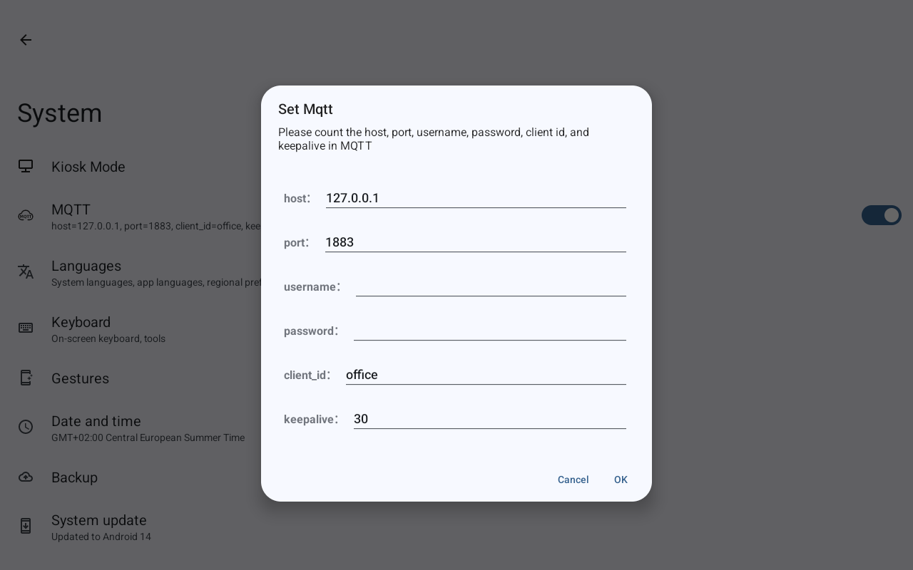

# SMT101x Sensors for Kiosk Satellite

Bring your SMT101 tablet's built-in sensors and controls into Kiosk Satellite.
See temperature, humidity, and distance readings, check door inputs, and
control the relays and RGB lighting on supported models.

Everything can run locally on the tablet, without a separate MQTT server.
The plugin can also help keep the tablet's built-in MQTT client running,
so readings can resume after that client stops.

For firmware identifiers, MQTT topics and payloads, implementation details,
serial/IR investigation results, and build instructions, see
[Technical details](docs/TECHNICAL.md).

## What the plugin does

| Entity | Feature |
| --- | --- |
| Temperature | Temperature reading in degrees Celsius |
| Humidity | Relative humidity reading in percent |
| Distance | Distance reading in millimetres, on equipped units |
| Switch 1 / Switch 2 | Control the tablet's Relay 1 / Relay 2 outputs |
| Door 1 / Door 2 | Door input states |
| RGB Backlight | On/off, brightness, and RGB color controls |

Entities appear only after the tablet publishes a valid reading or status
for that feature. Not every tablet has or publishes every feature.
The display backlight is separate from the RGB light and is not controlled
by this plugin.

The plugin always hosts its local MQTT broker and can optionally restart a
stopped built-in MQTT client. External-only recovery mode is no longer available.

**Serial ports (RS232/RS485) and IR are not exposed by the current plugin.**
Investigation notes describe possible future work, not available features.

## Compatibility

The plugin has been checked on SMT1019-R157 V1.0A and V2.0 firmware.
Automatic recovery is restricted to the two exact builds listed in
[Known devices](docs/TECHNICAL.md#known-devices).

On V2.0, temperature, humidity, distance, and publisher recovery have been
verified. Switch and door status publications have been observed, but
physical input changes, relay commands, and RGB operation remain unverified.
Other SMT101-family devices and firmware are not currently confirmed.

## Installation

Releases are prepared in an automated release PR. Merging that PR creates
the versioned release; the package becomes available after its build and
verification finish. See [release workflow details](docs/TECHNICAL.md#automated-ci-and-releases).

1. Use the install button above, or download a plugin ZIP from
   [GitHub Releases](https://github.com/stuartp44/kiosk-satellite-plugin-smt101/releases)
   and install it through Kiosk Satellite's Plugin Manager.
2. Enable the plugin in Kiosk Satellite, then follow the [setup instructions](#setup).
3. Confirm that readings appear in Kiosk Satellite. If you use Home Assistant,
   confirm that the plugin's available entities appear there with the
   `SMT101x` prefix.

When testing a local ZIP on a fleet-managed tablet, disable plugin
synchronization first; otherwise the leader can replace it with the
configured release.

## Setup

### How the connections work

There are two separate connections:

1. The tablet's built-in MQTT client sends sensor and status messages to the
   plugin's embedded MQTT broker at `127.0.0.1:1883`. The broker starts when
   the plugin is enabled. This address is the tablet's own loopback address.
2. The plugin turns those messages into entities in Kiosk Satellite. Kiosk
   Satellite's built-in ESPHome API then exposes kiosk entities to Home
   Assistant. Home Assistant connects to Kiosk Satellite as an ESPHome device;
   it does **not** connect to the plugin's MQTT broker.

Controls travel back through Kiosk Satellite and the plugin to the tablet's
built-in MQTT client. You do not need a separate MQTT broker, ESPHome firmware,
or an ESPHome YAML configuration for this setup.

### 1. Point the tablet's MQTT client to the plugin

Open **Android Settings > System > MQTT** on the tablet. Set the built-in
client to the values below so it sends messages to the plugin's local broker.
Do not use the Home Assistant server's address here.

On the confirmed firmware, tapping the MQTT row while enabled turns the
publisher off; tapping it again opens the **Set Mqtt** configuration dialog.
This briefly interrupts sensor publications. If automatic re-enabling is
enabled, turn that plugin option off temporarily so recovery does not
interfere with configuration.

| Field | Value |
| --- | --- |
| host | `127.0.0.1` |
| port | `1883` |
| username | Leave blank |
| password | Leave blank |
| client_id | Keep your tablet's client ID, such as `office` |
| keepalive | `30` |

Tap **OK** to save, then ensure the built-in MQTT client is on. The switch
shows that MQTT is enabled; it does not confirm that messages are reaching
the plugin. Check the plugin status or log for a client connection and
incoming publications.

### 2. Configure optional plugin recovery

| Setting | Local-mode value |
| --- | --- |
| **Automatically recover stopped built-in MQTT client** | **On** for unattended recovery |
| **Automatically re-enable disabled tablet MQTT** | Optional: **On** if recovery should also turn the Android MQTT switch back on |

Restore automatic re-enabling after configuration if you want that behavior.
Leave it off to respect intentional MQTT disables.

The plugin does not rewrite Android's MQTT connection settings. If you
previously used an external server, change the tablet's server to
`127.0.0.1:1883` yourself. Previously saved broker-disable settings are ignored.

### 3. Expose the kiosk entities to Home Assistant

First, in Kiosk Satellite, open **Settings > ESPHome**, turn on
**Enable ESPHome**, and make a note of the encryption key shown there. Ensure
**Expose kiosk entities** is enabled; it allows Kiosk Satellite entities,
including entities provided by plugins, to be sent to Home Assistant.

Then, in Home Assistant, open **Settings > Devices & services** and configure
the discovered ESPHome device for Kiosk Satellite using that key. The device
is Kiosk Satellite (typically named `ks-<device name>`), not a separate
SMT101x ESPHome device. If it is not discovered automatically, follow the
[Kiosk Satellite ESPHome guide](https://kiosksatellite.com/docs/esphome/) or
the [Home Assistant ESPHome integration instructions](https://www.home-assistant.io/integrations/esphome/)
to add it manually using the kiosk's network address and ESPHome API port
(default `6053`, unless changed in Kiosk Satellite).

Once connected, the entities provided by this plugin appear in Home Assistant
with the `SMT101x` name prefix and can be used in automations. An entity only
appears after the tablet publishes a valid reading or status for that feature;
available entities therefore depend on the tablet's hardware and firmware.

## Configuration reference

| Setting | Default | What it does |
| --- | --- | --- |
| **Automatically recover stopped built-in MQTT client** (`enableAutomaticMqttRecovery`) | Off | Restart the tablet's built-in MQTT client if it stops, so readings can resume. Works on supported firmware once the local broker is listening. Does not fix a client that is running but disconnected. MQTT stays switched off unless automatic re-enabling is also enabled. |
| **Automatically re-enable disabled tablet MQTT** (`reenableDisabledMqtt`) | Off | Turn the tablet's MQTT switch back on if it has been disabled. Requires automatic recovery. Leave this off if you want to be able to turn MQTT off yourself. Connection settings stay unchanged; turning MQTT on does not guarantee delivery of readings. |

## Important behavior and limitations

### RGB light effects

The RGB light offers **Rainbow**, **Breathe**, **Candle**, and warning flashes
in **Red**, **Amber**, **Yellow**, **Green**, **Cyan**, **Blue**, **Magenta**,
and **White** in its Home Assistant effect list.
Rainbow cycles through colors, Breathe pulses the current color's brightness,
and Candle produces a warm flicker. Warning effects alternate the selected
color with off, holding each phase for half a second after its commands finish.
Starting or restarting a warning effect always sends OFF first and holds it
for half a second before the first flash.
Flashing lights may be uncomfortable for
some people; do not use these effects as safety-critical warnings.

Effects run in the plugin using repeated MQTT commands, not in the hardware.
Smooth effects send only changed MQTT values, compared after rounding to the
tablet's brightness and RGB ranges. Routine effect commands and RGB status
echoes are not logged; effect starts/stops, invalid status, and delivery errors
remain logged. Warning flashes keep their explicit power/color commands.
Home Assistant shows the light on, white, and at 100% brightness with the effect
selected throughout the animation, including the dark phase of a warning flash.
These display values do not change the actual effect color or brightness.
They use the brightness selected when the effect starts. Select **None** or
send a manual power, brightness, or color command to stop an effect.
Stopping leaves the last applied light state in place; send an explicit
command if you want a particular final color or power state.
Effects stop on settings changes, disable, or a command delivery failure;
they are not saved or automatically resumed. Physical appearance on the
tablet remains to be verified.

On startup or after settings changes, the info bar shows
`Detecting device capabilities, please wait.`
If no MQTT publications arrive within 60 seconds, it shows a setup error with
a link to the [tablet MQTT setup](#1-point-the-tablets-mqtt-client-to-the-plugin).
A connected client alone does not count as a publication. The first
publication clears the startup error; valid readings
then identify the capabilities actually present. Settings changes restart the wait.
Automatic recovery progress stays in the log and cannot clear this error before
MQTT publications arrive.
When a feature first sends a valid reading or status, the plugin posts an
informational message such as `Detected capabilities on this device:
Temperature, Humidity, Distance, RGB light.` The list grows as more features
are detected and resets on restart or settings changes. Later operational
status messages or errors can replace it. It creates no additional entities.

The plugin automatically learns command topic prefixes from valid status
messages. There is no manual client-ID setting in the plugin; any previously
saved override is ignored. Keep the tablet's own Android MQTT client ID as is.

- **MQTT clients connected:** The first Remote Admin overview tile is titled
  **MQTT Broker**, with the connected-client count and detected MQTT client IDs
  underneath. The count updates on connection changes; a connected client does
  not guarantee sensor readings are arriving.
  The indicator is red with no clients and green with one or more clients.
  For example: `1 client connected: office`. IDs come from the clients'
  MQTT connection requests, not a manually configured name.
  Disconnected IDs are removed; long lists are shortened to fit the tile.
- **Last MQTT Broker payload:** A second Remote Admin tile shows the actual latest
  payload. When **Automatically recover stopped built-in MQTT client** is
  enabled in local mode, its indicator is green when received less than 60
  seconds ago, or red after 60 seconds and before the first message.
  Otherwise it stays neutral. The payload remains
  visible regardless. This indicator does not change recovery or re-enabling.
  It shows the latest
  payload, such as `{"temperature":26.4}`. Payloads longer than 80 characters
  are shortened with `...`; control characters are displayed as spaces.
  Empty payloads show `(empty payload)`. Only the latest preview is retained.
  Before the first message it shows `Waiting for first message`. It resets when the
  plugin restarts or its settings change.
  Updates are limited to once per clock second during traffic; the existing
  minute refresh also displays the latest preview after a burst.
  Neither tile creates an ESPHome or Home Assistant entity.
- **Relay safety:** Switch 1 and Switch 2 control physical relay outputs.
  Their connected loads, contact types, and electrical ratings are not
  established by this project. Check your device documentation and wiring.
  Commands operate immediately without confirmation; keep unsafe or
  unverified loads disconnected while testing.
- **RGB on connection:** In local mode, the plugin turns the RGB light off
  if its first valid power status after an OEM MQTT connection is `ON`.
  This applies on reconnects too. Later power changes are left alone.
  A user RGB command before that first report cancels the check.
- **Stale readings:** Temperature, humidity, and distance readings become
  `Unknown` after 30 minutes without an update. Door and switch states do
  not expire because the built-in MQTT client may report them only when they change.
- **Settings changes:** Existing local entities are removed and reappear
  after their next valid publication.
- **Recovery:** Checks run once per minute; restart attempts and failed
  checks have a five-minute cooldown. Recovery leaves running publishers
  and intentionally disabled MQTT unchanged unless re-enabling is enabled.
  Turn re-enabling off before intentionally disabling tablet MQTT.
- **After reboot:** Recovery resumes when Kiosk Satellite starts the enabled
  plugin. Configure Kiosk Satellite to launch on boot if needed.
- **Disabling recovery:** Stops new checks but may not cancel an operation
  already submitted. Disabling the plugin does not stop the built-in MQTT client.
- **Diagnostics:** Ten minutes without MQTT publications produces a status
  warning. Check the plugin status and log for connection, command, broker,
  or recovery failures. See [technical diagnostics](docs/TECHNICAL.md#entity-state-refresh-and-diagnostics)
  for detailed behavior.

## Disclaimer

This is an independent community plugin, not affiliated with, endorsed by,
or supported by Apolosign or the manufacturers of SMT101-family devices
and their OEM firmware.

This plugin is provided "as is" and without warranties of any kind, to the
maximum extent permitted by applicable law. Use it at your own risk. You are
responsible for deciding whether it is suitable for your device and setup,
reviewing its settings, and testing its behavior. The plugin can interact
with the built-in MQTT client and device controls; do not rely on it for safety-critical
or other essential functions. To the maximum extent permitted by applicable
law, the author is not liable for damages or losses arising from use of the
plugin. Your statutory rights are not affected. See the Apache-2.0
[LICENSE](LICENSE) for the full warranty disclaimer and limitation of liability.
