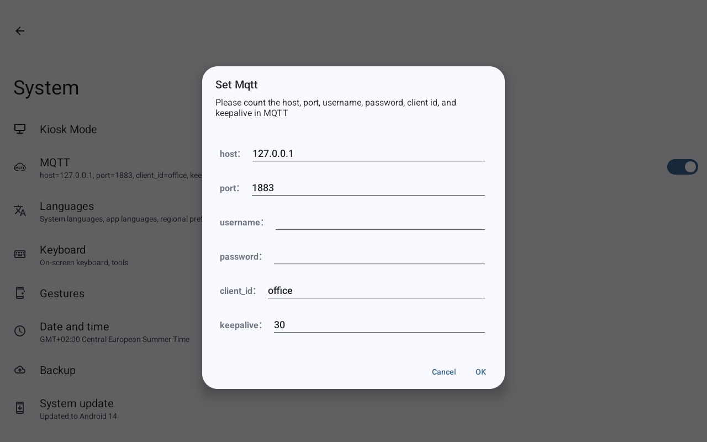

# SMT101x Sensors for Kiosk Satellite

This SDK 1 Kiosk Satellite plugin exposes the tablet's temperature,
humidity, switch/door inputs, and RGB backlight as Kiosk Satellite entities.

## Confirmed hardware

This plugin is developed and confirmed against:

```text
ZX-SMT1019-R157-V1.0A-10.1-GG-K1.29U-20260707
```

Other SMT101-family devices or firmware versions may use different MQTT
topics, payloads, or hardware interfaces and are not currently confirmed.

## Sensor sources

| Entity | Source | Metadata |
| --- | --- | --- |
| Temperature | OEM MQTT publication | `°C`, temperature, measurement, 1 decimal |
| Humidity | OEM MQTT publication | `%`, humidity, measurement, 0 decimals |
| Switch 1 / Switch 2 | OEM MQTT status and command topics | Writable switches |
| Door 1 / Door 2 | OEM MQTT status publications | Binary sensors with the `door` device class |
| RGB Backlight | OEM MQTT command and state topics | On/off, brightness, and RGB color |

The plugin does not inspect `/dev/input`.
Optional automatic recovery uses the tablet's exported
`com.broadcastinterface.ApiSystemService` to start a stopped OEM publisher.

## Configuration

| Setting | Type | Default | Notes |
| --- | --- | --- | --- |
| `enableEmbeddedMqttBroker` | boolean | `true` | Hosts the MQTT capture broker used to receive OEM sensor publications. |
| `mqttClientId` | string | blank | Must match `client_id` in the tablet's MQTT settings, such as `office`. Blank enables automatic discovery. |
| `enableAutomaticMqttRecovery` | boolean | `false` | Opt-in recovery of the stopped OEM MQTT publisher through the OEM system service. |
| `reenableDisabledMqtt` | boolean | `false` | Allows enabled recovery to override the tablet's MQTT disable setting in either mode. |

## Operating modes

### External MQTT recovery

Turn **Host MQTT capture broker on this tablet** off and enable
**Automatically recover stopped OEM MQTT publisher**. Keep the server
address, port, credentials, and client ID already configured in
**Android Settings > System > MQTT**.

The plugin checks the OEM process once per minute and starts it if stopped.
This can recover crashes triggered by Wi-Fi interruptions or updates that
stop the publisher, once the configured server is reachable again.
It does not restart a running but disconnected process, confirm external
broker delivery, or repair Wi-Fi, authentication, or server failures.
The OEM client remains responsible for its own reconnect behavior.
External readings and commands continue through your existing MQTT setup;
they are not bridged into Kiosk Satellite by this plugin in this mode.

### Local sensor management through Kiosk Satellite

Turn **Host MQTT capture broker on this tablet** on and configure the tablet's
MQTT server as `127.0.0.1`, port `1883`. The plugin receives sensor and door
readings and exposes switch and RGB controls through Kiosk Satellite.
No separate MQTT server is required: MQTT still runs internally between
the OEM publisher and the plugin's built-in loopback broker.
Enable automatic recovery to restart a stopped publisher in this mode too.

#### Tablet MQTT settings

Open **Android Settings > System > MQTT**. On the confirmed firmware,
tapping the MQTT row while enabled turns the publisher off; tapping it
again opens the **Set Mqtt** configuration dialog. This briefly interrupts
sensor publications. If automatic re-enabling is enabled, turn that plugin
option off temporarily so recovery does not interfere with configuration.

Use these values for the built-in local broker:

| Field | Value |
| --- | --- |
| host | `127.0.0.1` |
| port | `1883` |
| username | Leave blank |
| password | Leave blank |
| client_id | `office` in this example; keep your tablet's client ID |
| keepalive | `30` |



Tap **OK** to save and enable the OEM MQTT publisher. Ensure the MQTT switch
is on when finished. The switch indicates that MQTT is enabled, not that
sensor publications are reaching the plugin.

#### Plugin settings

| Setting | Local-mode value |
| --- | --- |
| **Host MQTT capture broker on this tablet** | **On** |
| `mqttClientId` | Leave blank for automatic discovery, or match the tablet's `client_id` |
| **Automatically recover stopped OEM MQTT publisher** | **On** for unattended recovery |
| **Automatically re-enable disabled tablet MQTT** | Optional: **On** if recovery should also turn the Android MQTT switch back on |

Restore automatic re-enabling after configuration if you want that behavior.
Leave it off to respect intentional MQTT disables. Confirm that real sensor
readings appear in Kiosk Satellite after saving the tablet settings.

Changing modes does not rewrite the tablet's MQTT connection settings.
Configure the correct server address in Android settings when switching.
Optional automatic re-enabling works in either mode and only changes the
MQTT enable switch, not the configured connection.

### Automatic OEM publisher recovery

The confirmed firmware declares `iot_mqtt_client` as a disabled, `oneshot`
Android init service. It does not automatically restart after a crash, even
when `persist.start.mqtt` remains `1`. This leaves sensors `Unknown` while
the plugin's broker is still listening.

To enable recovery, enable **Automatically recover stopped OEM MQTT
publisher** in the plugin page. Capture continues to work with recovery
disabled. After reboot, recovery resumes when Kiosk Satellite starts the
enabled plugin; ensure Kiosk Satellite is configured to launch on boot.

The plugin checks the service once per minute. Local mode waits until the
embedded broker is listening; external mode does not start a local broker.
On the confirmed firmware only, when tablet MQTT is enabled
(`persist.start.mqtt=1`) and the service is `stopped`, it reapplies
the MQTT start property through the OEM Binder service's
`setSystemProperties` operation. Android init starts the OEM service with its
normal identity; the plugin does not launch a daemon itself.
It verifies that the service is running after two seconds and logs that it
is waiting for publications in local mode. In external mode it reports only
that the publisher is running; external broker delivery is not monitored.
Actual sensor readings still come exclusively
from MQTT, not from the restart result.
Once a real MQTT publication arrives, the recovery status changes to
`MQTT publications are being received`. Publications arriving before the
restart confirmation are also recognized, so the confirmation cannot
overwrite active reception with a stale waiting message.

Running services and disabled tablet MQTT are left unchanged by default.
Enable **Automatically re-enable disabled tablet MQTT** to explicitly allow
recovery to change `persist.start.mqtt` from `0` to `1`. This option only
applies while automatic recovery is enabled, in either mode.
It overrides intentional tablet MQTT disables, but does not change the MQTT
broker address, port, credentials, or client ID. Successful re-enabling is
logged separately and verified by checking both the enable property and the
running service; sensor readings still require actual MQTT publications.
Re-enabling uses the same five-minute cooldown as restarting.
Turn this option off before intentionally disabling tablet MQTT.

Restart attempts
and failed checks are limited to once every five minutes. Rejected service
bindings, unexpected service states, unsupported firmware, timeouts, and
transaction failures are reported in the plugin status and log. Disabling
recovery or the plugin stops new checks; an already submitted operation may
finish. The plugin does not stop the OEM publisher when disabled.

The Binder descriptor and transaction number are verified for the confirmed
firmware only. Recovery sends only the fixed `persist.start.mqtt=1` operation;
it does not expose arbitrary OEM commands or property writes. SDK 1 has no
Android Context accessor, so recovery obtains the host application using
`ActivityThread.currentApplication`, verified on this firmware with target
SDK 36. If a future host or firmware blocks that lookup, recovery reports
the failure rather than silently claiming success.

## Embedded MQTT sensor bridge

Point the tablet's OEM `iot_mqtt_client` at `127.0.0.1` and port `1883`.
The broker port is fixed and is not exposed as a plugin setting.
The broker binds exclusively to IPv4 loopback, so connections from the
tablet's LAN address or another device are not accepted. It supports MQTT
3.1, 3.1.1, and 5 and the protocol operations needed to capture
publications. It is not a general-purpose persistent broker.
It accepts multiple concurrent loopback clients, allowing OEM builds that
use separate MQTT connections for sensor publishing and command
subscriptions to operate correctly.

The broker recognizes these topic tokens:

- Temperature: `temperature`, `temp`, `ths`
- Humidity: `humidity`, `humid`, `hum`, `moisture`

Payloads may be plain numbers or JSON objects with matching keys. Known OEM
examples are:

```text
office/sensors/temperature {"temperature":26.4}
office/sensors/humidity {"humidity":38.5}
office/switch1/status {"state":"OFF"}
office/switch2/status {"state":"OFF"}
office/door1/status {"state":"OFF"}
office/door2/status {"state":"OFF"}
```

The prefix is not fixed: any topic ending in `/switch1/status`,
`/switch2/status`, `/door1/status`, or `/door2/status` is recognized.
`ON` maps to active/open and `OFF` maps to inactive/closed.
Switch commands are published as plain `ON` or `OFF` payloads to the
corresponding `/switch1/set` and `/switch2/set` topic. Switch status
publications remain JSON, for example `{"state":"ON"}`. The switches appear
after their first status publication establishes a confirmed state and
topic prefix.

The RGB backlight learns the topic prefix (for example `office`) from the
tablet's live status publications:

```text
office/light/status       {"state":"OFF"}
office/brightness/status  {"brightness":20}
office/rgb/status         {"rgb":[255,255,255]}
```

Power commands are sent to `light/switch` as plain `ON` or `OFF` payloads.
RGB commands are sent to `rgb/set` as plain comma-separated channels such
as `255,193,141`. Brightness commands use `brightness/set` with a plain
0–100 value. Status publications remain JSON.
`office/backlight/status` is the tablet display backlight, not the RGB
light, and is intentionally ignored.

### MQTT client ID and topic prefix

The **MQTT client ID (optional)** setting corresponds to `client_id` in the
tablet's MQTT settings. The OEM client also uses that value as the prefix for
its status and command topics. In the examples above the `client_id` is
`office`, but another tablet may use `kitchen` or `hall-panel`.

Leave **MQTT client ID (optional)** blank to learn the prefix from the
tablet's `/status` publications. Set it explicitly to the same value as
`client_id` in the tablet's MQTT settings. For example, setting both to
`kitchen` sends RGB commands to `kitchen/light/switch`,
`kitchen/brightness/set`, and `kitchen/rgb/set`, and switch commands to
`kitchen/switch1/set` and `kitchen/switch2/set`.

Do not include a leading or trailing slash. The plugin removes those if
entered. MQTT wildcards (`+` and `#`) are not valid in this setting.

The plugin log records the topic filters requested by the OEM MQTT client
and every outbound RGB or switch command. When a firmware publishes status
without subscribing to command topics, the loopback broker also sends the
command directly to its connected OEM MQTT client and logs that fallback.

The broker accepts any MQTT client credentials, but its loopback-only bind
keeps it inaccessible to other devices.

### Entity state refresh and diagnostics

Every 60 seconds the plugin re-sends the last received temperature,
humidity, door, and switch states to Kiosk Satellite. A reading that was
dropped by the host therefore recovers without waiting for the OEM value to
change. The cache is reset, and the entities return to `Unknown`, when the
plugin starts or its settings change.

Temperature and humidity readings older than 30 minutes are not re-sent;
they are set to `Unknown` and the log records
`No sensor.<name> reading received for 30 minutes`. Door and switch states
may only be published by the OEM client when they change, so they do not
expire. If no MQTT publication of any kind arrives for 10 minutes, the plugin
logs and shows a status warning with the number of open OEM MQTT client
connections. It reports `MQTT publications resumed.` when publications
arrive again.

Every OEM MQTT client disconnect is logged with its client ID, reason (for
example `DISCONNECT received`, `connection closed by client`, or
`Read timed out`), and connection duration. If the broker stops listening,
for example because port 1883 is still held, it retries after 5, 10, and
then every 30 seconds, and shows a status until it recovers.

If Kiosk Satellite rejects an entity update, the plugin logs
`Kiosk rejected <entity> update ...` at most once per minute per entity and
writes the same line to logcat via `System.err`. When updates are accepted
again, it logs `Kiosk accepted <entity> updates again.` If the rejection
means Kiosk has ended the plugin session, the plugin logs
`Kiosk ended this plugin session` and stops its broker so the next session
can bind port 1883.

Switch and RGB backlight commands are sent from a dedicated plugin thread,
so a stalled MQTT write cannot trip Kiosk's plugin callback timeout.

## Build and test

Requirements:

- JDK 17 or newer
- Gradle 9 or newer
- Android SDK with an installed platform and build-tools containing `d8`
- `ANDROID_HOME` or `ANDROID_SDK_ROOT`

Run:

```bash
gradle clean build
```

The installable ZIP and SHA-256 checksum are generated in `dist/`.

## Automated CI and releases

Pushes, pull requests, and manual workflow runs execute the complete build
and test suite. Each run starts with `clean`, so its `smt101-plugin-dist`
GitHub Actions artifact contains only the current manifest, installable ZIP,
and SHA-256 checksum. CI artifacts are retained for 30 days.

Releases are fully automated with
[semantic-release](https://semantic-release.org). Every push to `main` runs
`.github/workflows/release.yml`, which reads the
[Conventional Commits](https://www.conventionalcommits.org) since the last
`v<version>` tag and decides the next version:

| Commit message                                   | Release         |
| ------------------------------------------------ | --------------- |
| `fix: ...`, `perf: ...`                          | patch (0.1.x)   |
| `feat: ...`                                      | minor (0.x.0)   |
| `feat!: ...` or a `BREAKING CHANGE:` footer      | major (x.0.0)   |
| `chore:`, `ci:`, `docs:`, `test:`, other text    | no release      |

When a release is due, `scripts/prepare-release.sh` writes the new version
into `kiosk-satellite-plugin.json`, runs the same clean build and tests, and
verifies the ZIP and checksum. semantic-release then commits the manifest back
to `main` as `chore(release): <version> [skip ci]`, tags `v<version>`, and
creates the GitHub Release with generated notes. After the new release
succeeds, older version releases and version tags are removed so only the
current package remains.

Each release uploads exactly one standalone `kiosk-satellite-plugin.json`
asset for Plugin Manager discovery, plus the installable ZIP and its
SHA-256 checksum.

Do not bump the manifest version by hand. When squash-merging pull requests,
use a Conventional Commit PR title (for example `fix: resend last MQTT values`),
because that title becomes the commit semantic-release analyzes.

## Installation

1. Build the plugin or download its ZIP.
2. Install the ZIP through Kiosk Satellite's Plugin Manager.
3. Configure the OEM MQTT client to publish to the tablet's embedded broker.
4. Confirm the plugin log reports an MQTT client connection and captured
   temperature/humidity publications.
